<h1>Hi 👋, I'm Mrunal Jagtap</h1>
<h3>Full Stack Developer · Learning AI/ML</h3>

  

&nbsp;&nbsp;

&nbsp;&nbsp;

 

- 🔭 Currently working on [Hotel Smart Management System](https://github.com/SpoidyMon/SHMS)
- 🌱 Currently learning **AI**
- 👯 Looking to collaborate with **QA Engineers & Testers**
- 💬 Ask me about **Full Stack**

 

<!-- ============================ TECHNOLOGIES ============================ -->
## 🛠️ Technologies

<!-- Languages -->

  

<!-- Frontend -->

  

<!-- Backend -->

  

<!-- Databases -->

  

<!-- Data & AI -->

  

<!-- Tools -->

  

 

<!-- ============================ CONTRIBUTION ACTIVITY ============================ -->

<h2>⚡ Contribution Activity</h2>

 

<!-- ============================ STATS: REPOS / STARS / STREAK ============================ -->

<h2>📊 Stats</h2>

 

<!-- ============================ COMMIT GRAPH ============================ -->

<h2>📈 Commit Graph</h2>

 

<!-- ============================ FEATURED PROJECTS ============================ -->

<h2>🚀 Featured Projects</h2>

<!--
  To add pinned-style cards later, copy this and change repo=... :
  
-->

 

<!-- ============================ TROPHIES ============================ -->

